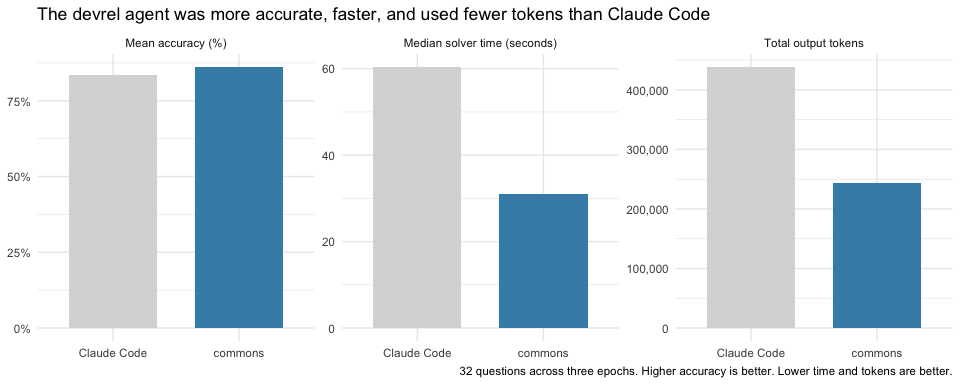

<!-- README.md is generated from README.Rmd. Please edit that file -->

# devrel agent

A [commons agent](https://github.com/posit-dev/commons) for exploring
the adoption, engagement, and growth of Posit open-source projects.

<div align="center">


</div>

The agent is more accurate, faster, and cheaper on devrel-related
questions than Claude Code placed in the devrel-io repository.

<div align="center">



</div>

The agent analyzes the
[devrel-io](https://github.com/posit-dev/devrel-io) data, which is an
automated collection of devrel metrics. devrel-io is built with
[posit-dev/velocirepo](https://github.com/posit-dev/velocirepo), a more
general data synthesis software.

## Run it locally

These steps are for running the agent on your own machine. The deployed
app on Connect Cloud is published with `deploy.R`.

The agent reads `data/velocirepo.duckdb` and its data dictionary,
`data/data-dict.yaml`. Both come from a clone of devrel-io in
`inst/devrel-io`, exported by
[velocirepo](https://posit-dev.github.io/velocirepo/user-guide/installation.html)
(1.2.0 or later):

``` bash
git clone --depth 1 https://github.com/posit-dev/devrel-io inst/devrel-io
velocirepo --config inst/devrel-io/velocirepo.toml export data --data-dict
```

To refresh the data later, run `git -C inst/devrel-io pull` and the
export again. velocirepo writes the dictionary from the schema, the data
and the `[data_dict]` section of devrel-io’s `velocirepo.toml`. Caveats
about the data belong in that section, so they reach the dictionary at
the next export.

Put your OpenAI API key in `.env`, in the repository’s root, as a line
`OPENAI_API_KEY=...`; the app reads it when it starts. Then, in R, from
the repository’s root, install the packages the app needs and start the
app:

``` r
pak::local_install_deps()
shiny::runApp()
```

To deploy from your laptop, add the Connect Cloud client credentials to
`.env` too (`CONNECT_CLOUD_CLIENT_ID=...` and
`CONNECT_CLOUD_CLIENT_SECRET=...`, and `CONNECT_CLOUD_APP_ID=...` once
the app exists), install rsconnect, and run `Rscript deploy.R`. `.env`
is never deployed.
